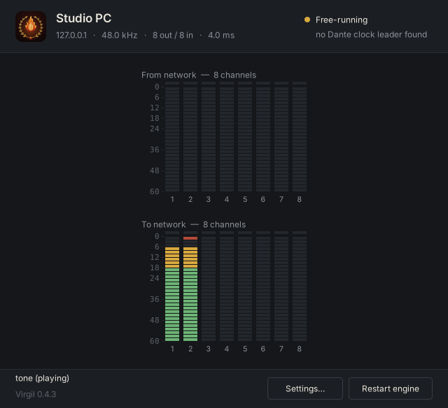

<p align="center"></p>

# Virgil: a low-latency virtual soundcard for Dante® networks

<p align="center"><em><b>V</b>irtual <b>I</b>nterface <b>R</b>outing <b>G</b>ateway for <b>I</b>nferno-based <b>L</b>ow-latency audio</em></p>

Virgil lets a computer join a **Dante network** as an audio device. In Dante
Controller it shows up next to your other gear, with its own transmit and
receive channels. You
route it like any other device, and your audio apps see an ordinary soundcard:

| OS      | Driver                         | Apps see it as                   |
|---------|--------------------------------|----------------------------------|
| Windows 10/11 | ASIO driver              | "Virgil" ASIO device (REAPER, Cubase, …) |
| macOS 11+ | Core Audio AudioServerPlugIn | "Virgil Virtual Soundcard" system device |
| Linux, Raspberry Pi | ALSA plugin          | `virgil` ALSA device (REAPER, JACK, PipeWire, aplay, …) |

<p align="center"></p>

**What you get**

- Up to 128 channels each way at 44.1–96 kHz, routed in Dante Controller like
  any other device, with receive and transmit latency down to a few
  milliseconds.
- **Virgil Control**, a native app on every platform (tray / menu bar icon,
  meters, clock state, settings, dropout diagnostics, channel names, the
  configuration file), plus a web panel that other computers can open too
  (*Allow remote access*, password protected; off by default).
- **Desktop audio**: send what your apps play (one app, everything, or all
  but Virgil) into Dante, and listen to Dante channels on your speakers or
  headphones, without extra drivers or virtual cables.
- **Audio interface inputs and outputs**: route an audio interface's inputs
  straight into Dante and Dante channels to its outputs, up to 64 each way,
  through the interface's own ASIO driver on Windows, Core Audio on macOS, or
  PulseAudio / PipeWire on Linux.
- **Latency you can tune safely**: Virgil measures its own timing and
  suggests the lowest transmit latency your computer handles; an optional
  0.5 ms mixing tick lowers it by another millisecond.
- Follows network changes (a new address, another Wi-Fi network, an adapter
  plugged in) by itself, and keeps a dropout log you can save as a report.
- Follows the Dante clock leader (PTPv1), or leads the clock itself when
  there is no Dante hardware.
- Several apps can play at once; they are mixed.
- **Stop / Start** in Virgil Control takes Virgil off the Dante network
  completely and brings it back; a stopped Virgil stays stopped across
  restarts until you start it again.
- Installers for Windows, macOS, Debian/Ubuntu, Fedora and a one-step
  installer for the Raspberry Pi; portable versions that need no install.

Virgil (Dante's guide through the *Inferno*) is built on
[**Inferno**](https://github.com/teodly/inferno), an independent open-source
implementation of the Dante protocol by Teodor Woźniak and contributors. Inferno
is vendored in `third_party/inferno` with a few patches; see its README.

> **Independent project.** Virgil is not affiliated with, authorized,
> endorsed or certified by Audinate, and contains no Audinate software,
> firmware or documentation. Dante® is a registered trademark of Audinate Pty
> Ltd., used here only to say which networks Virgil works with. Virgil is free
> software under the GPLv3 (see `LICENSE`) and comes with no warranty. See
> [`NOTICE.md`](NOTICE.md) for all trademarks and third-party licences.

## Using it with Dante Controller

1. Install Virgil and start it (the installers run it as a service).
2. In **Virgil Control**, pick the network interface your Dante network is on.
3. In **Dante Controller**, the computer appears as a device called
   **Virgil-<computer name>** (rename it in Settings). Its receive channels
   appear in the routing grid. Subscribe them to any Dante transmitter, and
   subscribe other devices to Virgil's transmit channels. Virgil remembers subscriptions across restarts.
4. Play into and record from the Virgil soundcard in your apps.

Clocking: Virgil follows the Dante clock leader (PTPv1, as Dante uses). If no
other Dante device provides a clock, for example when Virgil machines only
talk to each other, tick *Become clock leader when no Dante device provides
one* in Virgil Control's settings on one of them (`master_capable = true` in
`[ptp]`).

Stop / Start: *Stop* in Virgil Control (or the tray / menu bar menu, or the
browser panel) takes Virgil off the network: no Dante device, no network
ports in use. The service keeps running so the controls keep working, and
the choice is saved as `enabled = false` in `[device]`, so Virgil stays
stopped after a restart or reboot until you press *Start*.

Latency: Virgil's **receive latency** (`latency_us`, default 4 ms) works like
the device latency in Dante Controller. Its **transmit latency**
(`tx_latency_us`, default 4 ms): Virgil timestamps its audio that far ahead, so receivers get it in
time whatever their own latency (even 0.25 ms on hardware). Playback through
Virgil therefore reaches the network `tx_latency_us` plus the receiver's
latency after the app plays it. Lower
both on a clean, wired gigabit network. Raise them if you hear dropouts.
Virgil suggests a transmit latency for your computer after watching it for
half an hour, see [Transmit latency and the mixing tick](#transmit-latency-and-the-mixing-tick).

Network ports (allow them through the firewall; the Windows installer does):
UDP 319/320 (PTP), 5353 (mDNS), 4440, 4455, 8700 and 8800 (Dante control),
and the audio flows. With `ports = auto` (the default) Virgil uses
24440–24443 instead of the four control ports when other Dante software on
the computer already has them (see below), so allow those too if your
firewall filters by port. Virgil needs administrator/root rights for the PTP
ports.

Dante Controller can run on the same computer as Virgil. Its background
service listens on the standard Dante control ports, so Virgil then moves to
24440–24443 (it says so in the log) and Dante Controller finds it there by
itself. The same applies to Dante Virtual Soundcard, but the two cannot run
at once: both need the PTP clock ports 319/320.

## Architecture

```
 apps ─► ALSA plugin ─┐                               ┌─► Inferno ─► Dante flows ─► network
 apps ─► CoreAudio  ──┼─► shared-memory soundcard ◄───┤   (discovery, control, audio)
 apps ─► ASIO driver ─┘   (lock-free, per-frame        └─◄ Inferno ◄─ Dante devices
                           addressed by media clock)
                                    ▲
                    virgild daemon ── PTPv1 follower (or leader), mixer, control panel
```

* **One clock.** `virgild` steers a media clock to the Dante clock leader with a
  PI servo. It publishes a `(host time, media frame, rate)` anchor in shared
  memory. Every driver runs its callbacks from that anchor: CoreAudio zero
  timestamps, ASIO buffer switches and the ALSA hw pointer. Inferno gets the
  same clock in-process. Apps therefore run in lock-step with the network.
  There is no resampling and no drift correction anywhere.
* **Rings indexed by absolute media frame.** Frame *t* lives in slot
  `t mod ring`, in the apps' rings and in the 32-bit rings Inferno reads and
  writes. Received audio lands at the slot of its own timestamp plus the
  latency, which makes the ring a free jitter buffer. Playback from up to 8
  clients is summed by the daemon, so several apps can play at once without
  a lock.
* **Real-time path.** The daemon tick uses SCHED_FIFO (Linux), the
  time-constraint policy (macOS) or MMCSS "Pro Audio" (Windows). It wakes on an
  absolute deadline with a short final spin. Memory is `mlock`ed, nothing
  allocates after start-up, and audio threads never lock.

## Installing

Download from the repository's **Releases** page. Each platform has an
installer and a portable archive:

| Platform | Installer | Portable (no install) |
|---|---|---|
| Windows 10/11 x64 | `Virgil-<ver>-win64-setup.exe` | `Virgil-<ver>-windows-x64-portable.zip` |
| macOS 11+ (Apple silicon & Intel) | `Virgil-<ver>-macos.pkg` | `Virgil-<ver>-macos-portable.zip` |
| Debian 12+ / Ubuntu 22.04+ | `virgil_<ver>_amd64.deb` | `Virgil-<ver>-linux-x86_64.tar.gz` |
| Fedora / RHEL / openSUSE | `virgil-<ver>-1.x86_64.rpm` | same tarball |
| Raspberry Pi (64-bit Raspberry Pi OS 12+, other arm64 Linux) | `Virgil-<ver>-raspberry-pi-installer.sh` (one step), or `virgil_<ver>_arm64.deb` | `Virgil-<ver>-linux-arm64.tar.gz` |

**Raspberry Pi:** a Pi 4 or 5 on wired Ethernet works best; a Pi 3 or Zero 2 W
needs a USB Ethernet adapter, and Wi-Fi is not suitable for Dante. Use the
64-bit Raspberry Pi OS (32-bit is not supported).

The easiest way is the one-file installer. Download
`Virgil-<ver>-raspberry-pi-installer.sh` on the Pi, open **Terminal** (the
`>_` icon in the top bar; double-clicking the file only opens it in a text
editor) and run:

```sh
bash ~/Downloads/Virgil-*-raspberry-pi-installer.sh     # optional: --name "Stage Left" --interface eth0
```

Or, once the repository is public, in one line straight from GitHub:

```sh
curl -fsSL https://raw.githubusercontent.com/Audbol/Virgil-Virtual-Soundcard/HEAD/packaging/raspberry-pi/get-virgil.sh | sh
```

The installer installs Virgil and its dependencies, names the device
`Virgil-<hostname>` (Dante names must be unique), picks the wired network
port, keeps the CPU at full speed for low latency, starts the service, and
prints how to reach the control panel: http://127.0.0.1:8480/ on the Pi, or
from another computer through `ssh -L 8480:127.0.0.1:8480 pi@raspberrypi.local`.
It also asks whether Virgil should be the default ALSA device; say yes and
REAPER (Audio system **ALSA**, device **default**) and other ALSA programs use
Virgil without further setup. Desktop sound through PipeWire is not affected.
Change it later with `--default-device yes` or `--default-device no`.
Running it again upgrades Virgil and keeps your settings. A Pi has no
hardware timestamping, so expect a little more clock jitter than on a
desktop; raise the latencies if you hear dropouts.

**macOS:** if the macOS firewall is on, the `.pkg` allows incoming
connections for `/usr/local/bin/virgild` (Dante clock and control traffic);
with the firewall off it changes nothing, and `uninstall.sh` removes the
entry again. With the portable zip, allow *virgild* when macOS asks. On first
start Virgil Control asks to show notifications (service stopped, Dante clock
lost).

## Virgil Control

Virgil Control is a native app on every platform, with the same window: the
device name and address, the clock state, level meters for every channel from
the network (on top) and to the network (below), the apps that are playing,
how many dropouts the last hour had, and *Dropouts…*, *Settings…* and
*Restart engine* buttons.

- **Windows:** lives in the notification area (system tray) and starts with
  Windows. Right-click the icon for *Settings…*, *Desktop audio…*, *Restart
  audio engine*, *Open log*, *Start with Windows* and *Quit*. *Desktop
  audio…* brings Windows programs' sound to Dante (see below).
- **macOS:** lives in the menu bar (*Virgil Control* in Applications).
  The menu has the same entries plus *Start at login*; the log opens in
  Console. *Desktop audio…* (window footer and menu) brings the Mac's apps'
  sound to Dante (see below, macOS 14.2 or later for capture).
- **Linux and Raspberry Pi:** a GTK app with a tray icon (AppIndicator /
  StatusNotifier, or the classic system tray) that starts at login on desktop
  systems; *Show log* displays the service journal. Without a tray, closing
  the window quits it. *Desktop audio…* (window footer and tray menu) brings
  the desktop's sound to Dante, as on Windows (see below);
  `virgil-control --desktop-audio` opens that window directly.

Closing the window keeps the icon; Virgil itself (the service) runs either
way, and you are notified when the service stops or the Dante clock is lost.
The settings: device name, network interface, sample rate, channel counts,
receive and transmit latency and clock source.

The same controls are also available in a browser at http://127.0.0.1:8480/
(*Open control panel in browser* in the menu), which is handy on a headless
Raspberry Pi over SSH. It also has an editor for the raw configuration file.

### Dropouts and diagnostics

Virgil watches for everything that can make audio drop out and keeps a log of
it: audio from the network that arrived too late for the receive latency or
never arrived, apps that did not deliver their audio in time, the computer
keeping Virgil's engine waiting, and the clock leader being lost or the clock
jumping. *Dropouts…* (also in the tray menu as *Dropouts and diagnostics*)
opens the list in the control panel, with a chart of the last hour and
suggestions, such as the receive latency that would have covered the late
audio, and the transmit latency this computer needs (see below). *Download report* saves a text file with the setup, the events and the
recent log, to attach to a bug report.

### Transmit latency and the mixing tick

Virgil's sending thread hands each frame to the network a *send delay* after
its media time (two mixing ticks + 0.5 ms: 2.5 ms at the default 1 ms tick)
and stamps it *transmit latency* ahead. What is left over is the room the
thread has to wake up late; when it wakes later than that, audio to the
network is dropped (*Dropouts and diagnostics* lists it). Hence the minimum:
two ticks + 1.5 ms, i.e. 3.5 ms at the 1 ms tick.

**How to choose.** Start with the default (4 ms; 6 ms on Windows) and use the
computer as you normally do, with a Dante device receiving Virgil's channels.
While packets go out, Virgil records the latest wakeup of its sending thread.
After 30 minutes of sending, Settings (next to *Transmit latency*, in every
Virgil Control app and the web panel) and *Dropouts and diagnostics* show a
suggestion: send delay + the latest wakeup seen + 1 ms of margin, rounded up
to 0.5 ms, between the minimum and 40 ms:

* *can be lowered to X ms*: *Apply suggestion* puts it in the field; press
  *Apply* to save it. It only suggests going down by 0.5 ms or more.
* *should be raised to X ms*: the thread came within 1 ms of the limit, or
  audio was dropped (the number of late sends is given). Raise it.
* *the transmit latency of X ms is right*: nothing to do.

Before that it shows how far it is (*measuring, 12 of 30 min*); only time with
a receiver subscribed counts. The confidence grows with the time watched (low
under 2 hours, high after 8): the worst wakeup of a day is what matters, so
leave it running through a typical session (and a busy one) before trusting a
lower value. The observation is kept when settings are applied (also when you
change the transmit latency itself), and starts over with *Clear* in
*Dropouts and diagnostics*, when the mixing tick changes, and when the service
restarts. The diagnostics report has a line with the figures behind it
(`transmit latency suggestion (tick 1000 us, 7200 s of sending, worst wakeup
lag 0.31 ms, 0 late sends): …`); `/api/diagnostics` has them as
`tx_latency_suggestion`.

Dante receivers keep their own latency setting: Virgil stamps its audio a
transmit latency ahead, so a receiver at any latency gets it in time, and audio
played through Virgil reaches the receiver's output after Virgil's transmit
latency plus the receiver's latency.

**Mixing tick.** *Mixing tick* in Settings (`tick_us` in `[device]`) is how
often Virgil moves audio between the apps and the network: *1 ms (default)* or
*0.5 ms (lower latency, more CPU)*. At 0.5 ms the send delay is 1.5 ms and the
minimum transmit latency 2.5 ms, so a fast computer can go down to 2.5–3 ms.
The cost:

* CPU: the engine wakes twice as often and busy-waits `spin_us` (50 us) before
  each tick. Measured with `virgild` free-running (no Dante receiver, one
  playing app) on a 2.1 GHz Xeon VM: 8×8 channels about 3.3 % of one core at
  1 ms and 7 % at 0.5 ms; 64×64 about 5 % and 9 %.
* Apps' margin: drivers write two ticks ahead (`tx_lead_us = 0`), 1 ms instead
  of 2 ms at the 0.5 ms tick, so an ASIO / Core Audio / ALSA app that is late
  now and then is caught sooner (an *app did not keep up* dropout). Setting
  `tx_lead_us = 2000` gives the 2 ms back (it adds to the apps' output
  latency, not to the network's).
* Jitter: a packet holds up to 32 frames (0.67 ms at 48 kHz), so at 0.5 ms
  the engine itself may wake only about 0.3 ms late before the network gets a
  gap (0.8 ms at the 1 ms tick). On a busy computer stay at 1 ms.
* Windows needs Windows 10 version 1803 or later (high-resolution timers; the
  log warns otherwise).

Changing the tick restarts the audio engine; apps reconnect (the soundcard
layout changes). Other values from 125 to 4000 us can still be set in the
configuration file.

### Channel names

Name channels in *Settings… › Channel names…* (or in the control panel). The
names appear in Dante Controller, and ASIO and Core Audio apps show them as
channel names, e.g. `3 Kick In` in REAPER on Windows. Renaming a channel in
Dante Controller works too; Virgil saves that name in its configuration. In
the file they are a `[channel_names]` section:

```ini
[channel_names]
tx1 = Kick In
tx2 = Snare Top
rx1 = Talkback
```

Names have up to 31 characters, are unique per direction, and cannot contain
`=`, `.`, `@` or `"`. ASIO hosts read the names when they open the driver.

Routing is done in Dante Controller (or any Dante routing tool).

**Apply** validates the configuration, saves it and restarts the audio
engine inside `virgild`. Apps stay connected when the sample rate and channel
counts are unchanged. If those change, ALSA apps reconnect by themselves
and ASIO hosts get a driver reset request. On macOS the Virgil device
changes to the new format by itself (apps may briefly stop and restart it).

The panel only listens on 127.0.0.1 unless remote access is on. It refuses
requests addressed to other host names (DNS rebinding) and cross-site form
posts. Set `control_port = 0` in `[device]` to turn it off.

**Remote access** (off by default): tick *Allow remote access* in the panel's
Settings (on the Virgil computer) and set a password of 8 or more characters,
or set `remote_access = true` and `remote_password = …` in `[device]`. Other
computers then open `http://<Virgil computer>:8480/` and log in with that
password (any user name). Five wrong passwords lock that address out for
10 seconds. Other computers never see the password and cannot change the two
remote access settings; this computer needs no password. The panel is plain
HTTP: the password crosses the network unencrypted (HTTP Basic auth), so use
it on a trusted network, such as a production network that is not shared with
the public.

Configuration file and log locations, if you prefer editing by hand:

| Platform | Configuration | Log |
|---|---|---|
| Windows | `C:\ProgramData\Virgil\virgil.conf` | `C:\ProgramData\Virgil\virgild.log` |
| macOS | `/Library/Application Support/Virgil/virgil.conf` | `/Library/Logs/Virgil/virgild.log` |
| Linux | `/etc/virgil/virgil.conf` | `journalctl -u virgild` |

The Windows and macOS log is rotated at 5 MB; the previous one is kept as
`virgild.log.1`.

Upgrades keep your configuration. Uninstalling also keeps it:

- **Windows:** use Add/Remove Programs.
- **macOS:** run `sudo "/Library/Application Support/Virgil/uninstall.sh"`. Add `--purge` to delete the configuration too.
- **Linux:** use `apt remove virgil` or `dnf remove virgil`. `apt purge` deletes the configuration.

With no interface set, the service uses the first active network interface. It
waits for the network if the service starts at boot before the network is up.

### Desktop audio (Windows)

*Desktop audio…* in Virgil Control (window footer and tray menu) sends sound
from Windows programs — a browser, Spotify, system sounds — to Virgil's Dante
transmit channels, and can play Dante receive channels on a Windows output
device. There is no driver to install and no third-party software (no virtual
cable): Virgil Control records the audio with Windows' own loopback capture,
in your user session, while it runs (it starts with Windows).

Sources (*Add…*), each to a stereo pair of transmit channels or, mixed to mono,
to one channel; sources on the same channels are mixed:

- **Output device:** everything Windows plays on that device, e.g. your
  speakers. *Default output device* follows the device chosen in Windows'
  sound settings.
- **App:** one program by its file name (`chrome.exe`, `spotify.exe`), with
  the processes it starts. The list shows the apps that have played sound;
  any name can be typed. Apps that are not running are picked up when they
  start. Needs Windows 10 version 2004 or later.
- **All apps except Virgil:** everything, without what Virgil Control itself
  plays, so listening to Dante on the same PC does not echo back into Dante.
  Windows 10 version 2004 or later.

Each source has a gain (−60 to +12 dB) and mute, and a level meter and status
in the list. *Dante receive channels to a Windows output device* plays a pair
(or one channel on both sides) of receive channels on a device of your choice.

Good to know:

- Captured audio still plays on the device it was sent to. To hear it only
  through Dante, let those apps play on an output you do not listen to, or
  turn that device down (on most PCs its volume does not change what loopback
  captures; the app's own volume does).
- Do not play receive channels on a device you capture: that echoes back into
  Dante (the window warns). Use *All apps except Virgil* instead.
- The audio is converted to Virgil's sample rate (44.1/48/96 kHz devices are
  all fine) and follows the small difference between the PC's sound-hardware
  clock and the Dante clock with an adaptive resampler, so it never drifts
  out or clicks. It adds roughly 60–80 ms of latency: fine for music, video
  and calls, not for live monitoring (use ASIO for that).
- Desktop audio uses one of Virgil's 8 playback slots, *Desktop audio* in
  the app list (*playing* while it has sound). It pauses while Virgil is stopped
  and reconnects by itself when the service restarts or its channels change.
- Apps that use WASAPI exclusive mode are not captured, and some protected
  streams (DRM video) may be captured as silence.

The settings are per user, in `%APPDATA%\Virgil\desktop-audio.conf`:

```ini
[desktop-audio]
enabled = true

[source]
type = app          # device | app | all-apps
app = "spotify.exe"
channel = 1         # first transmit channel
mono = false
gain_db = -3
mute = false

[source]
type = device
device = default    # or the device id
channel = 3

[output]
enabled = true
device = default
channel = 1         # first receive channel (a pair unless mono = true)
gain_db = 0
```

To check capture on a PC without Virgil, the Windows build has
`desktop-audio-probe.exe` (in the Windows portable zip):
`desktop-audio-probe list` shows the Windows build, output devices and apps
with audio sessions; `desktop-audio-probe capture --app chrome.exe --seconds 5`
(or `--device default`, `--device 1`, `--pid 1234`, `--all-apps`) records to
`capture.wav` and prints packet statistics and the device clock's offset from
the PC clock.

### Desktop audio (Linux)

The same feature on Linux desktops (Virgil Control for Linux, *Desktop
audio…* in the window footer and tray menu): sound from apps to Virgil's
transmit channels, and receive channels to an output device, with no driver
and no virtual cable. It uses the PulseAudio client library, which talks to
PulseAudio and to PipeWire (`pipewire-pulse`, the default on current Ubuntu,
Mint, Fedora and Debian desktops). The library is loaded when desktop audio
is first used, so the package does not depend on it; without it the window
says that desktop audio needs PulseAudio or PipeWire.

- **Output device:** everything a device (a PulseAudio / PipeWire *sink*)
  plays, recorded from its monitor. *Default output device* follows the
  output chosen in the sound settings.
- **App:** every sound stream of one app, by its name as the sound settings
  show it (`Firefox`, `Spotify`) or its program file (`firefox`). The list
  shows the apps that have a stream open now; streams the app opens later
  (the next video, the next track) are picked up as they appear.
- **All apps except Virgil:** every app's streams, without Virgil Control's
  own (and without what plays on a sink whose name contains "virgil").
- **Audio interface inputs:** inputs of an audio interface (any PulseAudio /
  PipeWire *source* that is not a monitor), one transmit channel each:
  inputs *first*.. go to transmit channels *channel*.. (`Scarlett 18i20
  inputs 1-8 → TX 1-8`). The stream records all of the source's channels by
  index (no remixing) in 5 ms fragments and picks out the ones chosen, so the
  latency stays low: about 23 ms from the input to Virgil's transmit time
  (measured with a pipe source, Virgil's 2 ms transmit lead included). With
  PipeWire, choose the interface's **Pro Audio** profile (sound settings or
  `pavucontrol` › Configuration): the ALSA card then appears as one source
  with every input as its own channel (`AUX0`, `AUX1`, …), instead of a
  stereo "Analog" source. *Default input device* follows the system's.

Receive channels can also go to an **audio interface's outputs**, one each
(receive channels *channel*.. → outputs *first output*..; the interface's
other outputs get silence), through a playback stream with all of the
sink's channels by index and a 10 ms buffer: about 20 ms from Dante media
time to the device (measured on a 6-channel null sink, Virgil's 10 ms receive
latency not counted). Pick *Audio interface outputs* in the window's output
section; with PipeWire, again the *Pro Audio* profile. Using the same
interface for inputs and outputs is normal (there is no echo warning: it is
not a capture of what the device plays).

The rest is as on Windows: gain, mute, mono, a level meter and status per
source; receive channels to a device with a warning when that device is also
captured; one playback slot named *Desktop audio*; roughly 60 ms of latency
per direction (measured: about 117 ms from a device through Virgil and back
out to another device, Virgil's own 14 ms not counted); drift between the
sound hardware and the Dante clock followed by the adaptive resampler. To
hear captured apps only through Dante, play them on a virtual output:
`pactl load-module module-null-sink sink_name=dante sink_properties=device.description=Dante`
(add it to `~/.config/pulse/default.pa`, or for PipeWire to a
`pipewire-pulse.conf.d` file, to keep it). Settings are per user in
`~/.config/virgil/desktop-audio.conf` (`$XDG_CONFIG_HOME`), the same format as
on Windows, with sink names as device ids and app names for `app`.

`VIRGIL_DA_DEBUG=1` in Virgil Control's environment adds the resampler
bridges' fill level and counters to the status texts.

### Desktop audio (macOS)

The same feature in Virgil Control for macOS (*Desktop audio…* in the window
footer and the menu bar menu; `"Virgil Control.app/Contents/MacOS/Virgil
Control" --desktop-audio` opens the window directly): sound from apps to
Virgil's transmit channels, and receive channels to an output device, with no
driver and no virtual cable. Capture uses Core Audio *process taps*, which
need **macOS 14.2 or later**; on older macOS only the receive channels →
output device part works, and the window says why.

- **Output device:** everything a device plays (all apps on it). *Default
  output device* follows the output chosen in System Settings › Sound.
- **App:** one app by name (`Safari`, `Spotify`) or bundle ID
  (`com.spotify.client`), with its helper processes (a browser's audio
  process counts as the browser). The list shows the apps playing sound now;
  the app is picked up again when it restarts or opens new audio processes.
- **All apps except Virgil:** every app, without Virgil Control itself and
  without apps that play on Virgil's own device (so nothing echoes back into
  Dante).
- **Audio interface inputs** (any macOS version): inputs of an audio
  interface or any other recording device, one transmit channel each (inputs
  *first*.. → transmit channels *channel*..), read directly with an IOProc on
  the device (128-frame buffer asked for, for Virgil Control only), across
  the device's input streams whether interleaved or not. *Default input
  device* follows System Settings › Sound. macOS asks once whether Virgil
  Control may use the microphone (that permission covers every audio input);
  if it was refused, the source says so: allow it in System Settings ›
  Privacy & Security › *Microphone* and turn the source off and on.

Receive channels can also go to an **audio interface's outputs**, one each
(receive channels *channel*.. → outputs *first output*.., silence on the
others, across the device's output streams), with a small buffer as for
inputs. Inputs and outputs of the same interface together are normal (no echo
warning).

The first time a source captures, macOS asks whether Virgil Control may
record this computer's audio. If that was refused, captured audio is silent
(macOS gives no error): the source's status then says so while its app plays.
Allow Virgil Control in System Settings › Privacy & Security › *Screen &
System Audio Recording* (on macOS 15 and later under *System Audio Recording
Only*) and turn the source off and on. Captured audio keeps playing on its
device as usual (taps do not mute it).

The rest is as on Windows and Linux: gain, mute, mono, a level meter and status
per source; receive channels to a device (its first two channels), with a
warning when that device is also captured; one playback slot named *Desktop
audio*; roughly 60 ms of latency per direction (interface inputs and outputs: a few
ms of buffering plus Virgil's own latency); drift between the Mac's audio
clock and the Dante clock followed by the adaptive resampler. Settings are per
user in `~/Library/Application Support/Virgil/desktop-audio.conf`, the same
format as on Windows, with Core Audio device UIDs as device ids and bundle IDs
(or names) for `app`.

## Building

Requirements: CMake ≥ 3.16, a C++17 compiler and a Rust toolchain (stable,
via [rustup](https://rustup.rs)); Cargo builds the vendored Inferno. Linux
also needs `libasound2-dev`.

```sh
cmake -S . -B build && cmake --build build -j && ctest --test-dir build
```

* **ASIO:** download the Steinberg ASIO SDK yourself (it is not
  redistributed). Then add `-DASIO_SDK_DIR=C:/path/to/asiosdk`.
* **Cross-compiling Windows from Linux:** `rustup target add
  x86_64-pc-windows-gnu`, then
  `cmake -B build-win -DCMAKE_TOOLCHAIN_FILE=cmake/mingw-w64.cmake -DASIO_SDK_DIR=…`
* **Cross-compiling for Raspberry Pi / arm64 Linux:** run
  `.github/setup-arm64-cross.sh` once on an x86-64 Ubuntu host, then
  `cmake -B build-arm64 -DCMAKE_TOOLCHAIN_FILE=cmake/aarch64-linux-gnu.cmake`.
  `VIRGIL_ARCH=arm64 packaging/linux/build-packages.sh deb` (or `portable`)
  builds the release files.
* **macOS universal build:** `rustup target add aarch64-apple-darwin
  x86_64-apple-darwin` and configure with
  `-DCMAKE_OSX_ARCHITECTURES="arm64;x86_64"`.

### Building the installers and portable archives

| Output | Command | Needs |
|---|---|---|
| `.deb` + `.rpm` | `packaging/linux/build-packages.sh` | `dpkg-dev`, `rpm` |
| Linux tarball | `packaging/linux/build-packages.sh portable` | — |
| Raspberry Pi `.deb` + tarball | `VIRGIL_ARCH=arm64 packaging/linux/build-packages.sh deb` (and `portable`) | see cross-compiling above |
| Raspberry Pi one-file installer | `packaging/raspberry-pi/build-installer.sh dist/virgil_<ver>_arm64.deb` | the `.deb` above |
| Windows installer + zip | `ASIO_SDK_DIR=… packaging/windows/build-installer.sh` | `g++-mingw-w64-x86-64`, `nsis`, `zip` (runs on Linux) |
| macOS `.pkg` + zip | `packaging/macos/build-pkg.sh` | Xcode command-line tools |

Output goes to `dist/`. The **Release** GitHub workflow builds them and
publishes a GitHub Release, with `SHA256SUMS` and the notes from
`packaging/release-notes.md`, when you push a tag such as `v0.2.0` or run it by
hand with a version. Run by hand, its **platforms** choice (all, windows,
macos, linux, raspberry-pi) builds and releases only that platform, for a fix
that only concerns one; the release notes then say so. The **CI** workflow
builds and tests every platform on each push.

* **macOS signing and notarisation:** for a local build, set
  `VIRGIL_CODESIGN_ID`, `VIRGIL_INSTALLER_ID` and `VIRGIL_NOTARY_PROFILE`
  (a `notarytool store-credentials` profile); the Developer ID identities
  must already be in your login keychain. In the Release workflow, signing
  only happens when the `MACOS_CERT_P12` (base64 `.p12` with both
  identities) and `MACOS_CERT_PASSWORD` secrets are set, together with
  `MACOS_CODESIGN_ID` / `MACOS_INSTALLER_ID`; notarisation additionally needs
  `MACOS_NOTARY_APPLE_ID`, `MACOS_NOTARY_TEAM_ID` and `MACOS_NOTARY_PASSWORD`
  (an app-specific password). Without them CI builds unsigned (ad-hoc
  signed) packages, which still install, but Gatekeeper asks the user to
  approve them in System Settings → Privacy & Security.
* **Windows signing:** the installer is unsigned, so SmartScreen warns on
  first run. Sign it with `signtool` if you have a certificate.

## Running

```sh
virgild --status                     # clock state, counters, connected apps
virgild -c my.conf -v                # run in the foreground with debug output
```

Configuration reference: [`config/virgil.conf.example`](config/virgil.conf.example).

* **Linux:** use `-D virgil` (automatic format conversion) or `-D virgil_hw`
  (raw), e.g. `jackd -d alsa -d virgil_hw -p 64`.
* **REAPER on Linux / Raspberry Pi:** Options → Preferences → Audio → Device:
  Audio system **ALSA**, input and output device **virgil_hw** (or
  **default** if the Pi installer made Virgil the default), sample rate
  48000, block size 128, 2–3 periods, 8 in / 8 out.

## Status and testing

| Component | How it was verified |
|---|---|
| Dante (Inferno) path | `tests/e2e_netns.sh`: two `virgild` instances in separate network namespaces, one as clock leader. The [netaudio](https://pypi.org/project/netaudio/) Dante CLI, standing in for Dante Controller, discovers both and subscribes B's receive channels to A's transmit channels. A 1 kHz tone played into A arrives at B sample-accurately, 168 frames (3.5 ms) later, with no dropouts. A probe asks for the clock status the way Dante Controller does. In use on Windows 11 with Dante Controller, a Behringer WING (clock leader) and an AVIO USB adapter |
| PTPv1 clock | Unit tests: message encoding, leader/follower lock, servo in simulation. Across namespaces the follower locks within about 10 µs |
| Engine, config | Unit tests; loopback through the Dante rings is bit-exact (24-bit), at the 1 ms and the 0.5 ms tick (4 and 128 channels); the desktop audio engine test also runs at both ticks; the transmit latency suggestion (rounding, minimum, raising after late sends, no churn) |
| ALSA driver | Real `aplay`/`arecord` through the daemon, 64-frame periods |
| Linux packages | `.deb` installed in a container; portable tarball used as a user would |
| Windows installer | In use on Windows 11; also run silently under Wine in development |
| ASIO driver | In use with REAPER on Windows 11; test host under Wine |
| Raspberry Pi (arm64) | In use with REAPER on a Raspberry Pi (64-bit Raspberry Pi OS); unit and loopback tests also run under QEMU in CI |
| CoreAudio driver, macOS `.pkg`, Virgil Control for macOS | Built by CI on macOS; **not yet run on a real Mac** |
| Virgil Control (Linux / Pi) | Run under X11 with a live daemon: meters, settings dialog and apply |
| Desktop audio (Linux) | `tests/desktop_audio_e2e.sh`: a private PulseAudio with null sinks and a free-running `virgild`; a tone from the default device, from one named app and from all apps arrives on the mapped transmit channels only; a round trip device → Virgil → receive channels → another device measures the latency (about 117 ms both ways); with Virgil's clock 150 ppm off, both bridges follow it; inputs 2-3 of a 4-channel pipe source (the "interface") arrive exactly on transmit channels 5-6, about 23 ms after they were written; receive channels 2-5 arrive exactly on outputs 3-6 of a 6-channel null sink (read back with `parec`), the other outputs silent, about 30 ms after their Dante media time (Virgil's 10 ms receive latency included). The engine itself: `ctest` (`desktop_audio`, against a fake sound system, including an 8-input interface to transmit channels 3-10 and receive channels to outputs 3-6 of an 8-output one) |
| Desktop audio (macOS) | `ctest` (`desktop_audio_coreaudio`, macOS only): the Core Audio backend lists output devices and playing apps, reports app capture exactly when macOS is 14.2 or later, lists recording devices with their input counts, refuses unknown devices and outputs a device does not have, and opens, runs and closes a render stream on the default output (skipped without one). Process taps themselves need the recording permission, so they are tested by hand |

Known limitations:

* Timestamps are software-only (kernel receive timestamps on Linux). Expect
  tens of µs of clock jitter. That is fine for audio, but Dante Controller
  may show the clock as less stable than hardware.
* Dante features Inferno does not implement are missing: AES67 mode, Dante
  Domain Manager, device locking, encrypted control, and changing latency
  or sample rate from Dante Controller (set them in Virgil instead).
* Changing the sample rate or channel counts restarts the audio engine;
  apps may briefly stop (ASIO hosts get a reset request, the macOS device
  changes format by itself).
* The Windows service creates a `Global\` shared-memory section that every
  user session can reach. A `virgild` started by hand from a non-elevated
  console falls back to `Local\`, which only that session can reach.
* On macOS, the HAL plug-in may run inside coreaudiod's sandbox, and that may
  block opening `virgild`'s POSIX shared memory. This has not been tested.

### Security notes

* The audio shared memory is meant for every local user's audio apps, so on
  Linux and macOS it is created world-readable and writable (0666; on Windows
  the service's `Global\` section is reachable from every session). Any local
  user can therefore read and inject audio, and can disrupt Virgil: shrinking
  the segment (`ftruncate`) makes `virgild` and the apps using it crash with
  `SIGBUS`. Clients validate the header they read, but nothing stops this
  denial of service. Do not run Virgil on a computer shared with untrusted
  local users.
